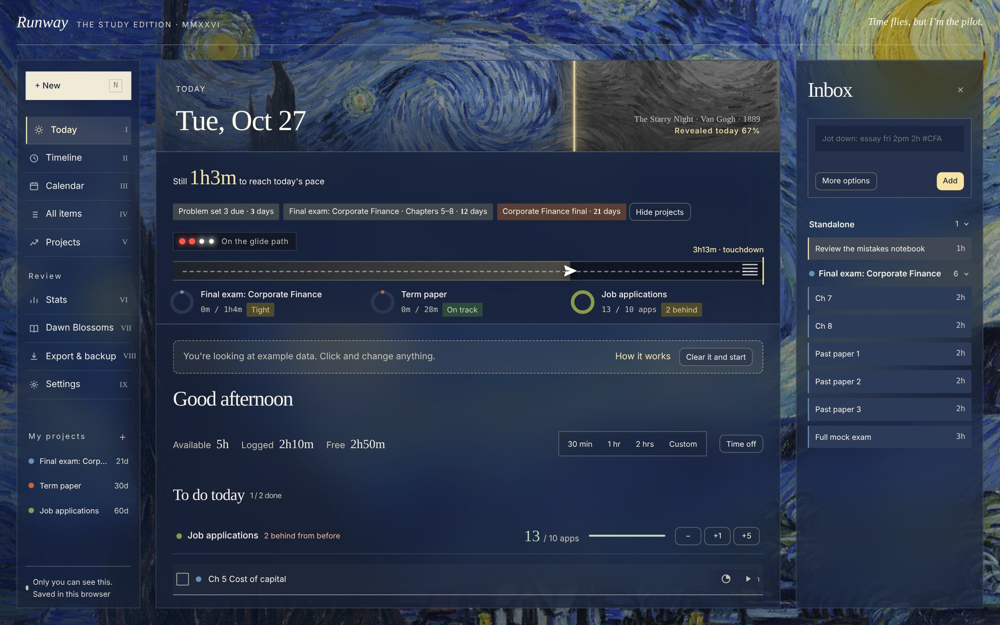
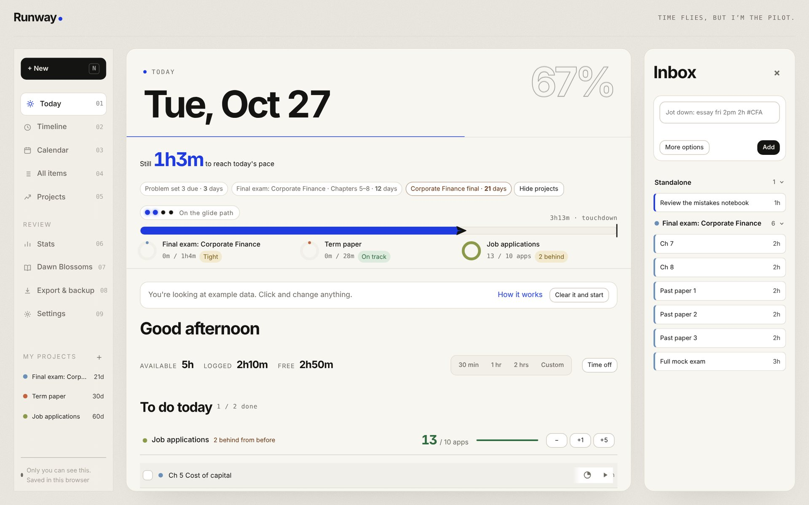
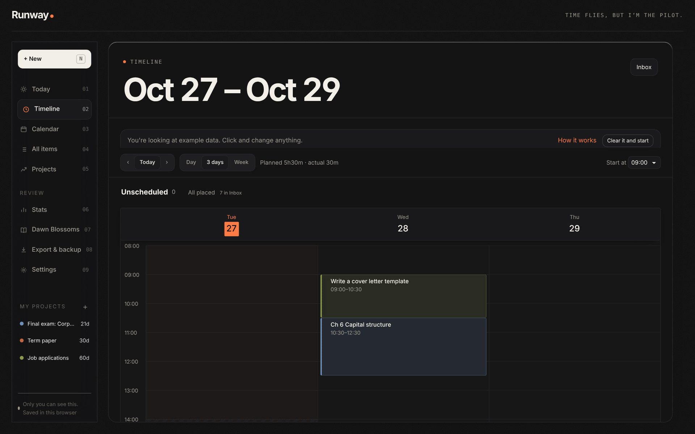
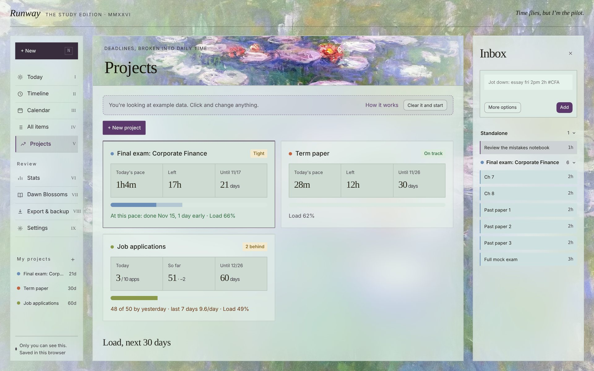
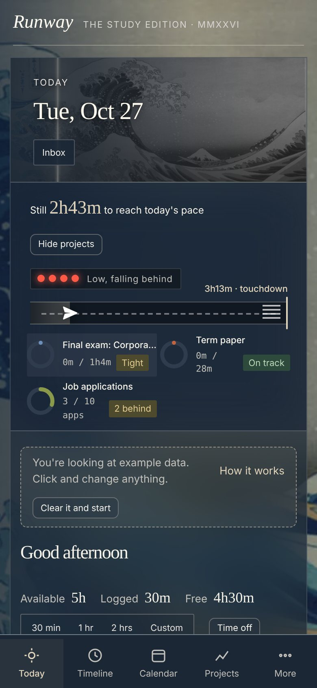

# Runway

> Time flies, but I'm the pilot.

**English** · [中文](#中文)

Runway plans backward from your deadlines. Tell it what is due and how many hours you have each day, and it works out today's **pace**: hold that pace and you touch down on time. If you do more or less than planned, the difference spreads over the days ahead, so the number you see is always the honest one for today.

One HTML file. No account, no server. Your data stays in your own browser.

**Try it:** [English](https://color19.github.io/runway/en/) · [follows your browser language](https://color19.github.io/runway/). On first open, press **Load an example** to look around with three sample projects, then clear them with one click.

## Features

- **Daily pace.** Every project is planned backward together, earliest deadline first, within the hours you set for each weekday. A runway bar, four glide-path lights and a painting that fills in with colour show how today is going.
- **Projects and modules.** Break a project into modules (each can have its own due date) and tasks with hour estimates. Add many at once with `Reading {1-10}`. Scheduling keeps chapter order and finishes each module before its due date or exam, and shows a preview before anything moves. Once you have finished a few tasks, Runway can rescale the remaining estimates to your real speed.
- **Count goals.** For work measured in numbers, not hours: 20 job applications a day, 50 problems a day. Log with +1 / +5 on Today; the status tells you how many you are behind instead of pretending you are on track.
- **Timeline.** Day, 3-day and week views. Drag tasks into time slots, resize them, or place everything automatically around fixed events. Timers record when you actually worked, and the day can run past midnight for late study sessions.
- **Calendar.** Month and week views, drag from the Inbox, double-click or right-click a day to add.
- **Quick add** in English or Chinese: `essay fri 2pm 2h #CFA`, `run every mon wed fri until 12/1`, `周五下午2点 写论文 2小时`, `@project` to file it under a project.
- **Time off.** Pick the days and see the cost first (how many tasks move, how much more each project needs per day). Your streak does not break, and you get a preview of where tasks go.
- **AI breakdown and weekly review.** Runway writes the prompt; paste it into any AI and paste the answer back.
- **Stats and Dawn Blossoms.** Trends, time split, heatmap, weekly rhythm, estimate vs actual. Each week's ticked-off tasks and notes are bound into a book you can page through.
- **Two looks.** The Paintings edition (The Starry Night, Water Lilies, The Great Wave, The Wreck of the Minotaur, Composition VII and the original Study) or the Minimal edition (paper and ink, big numerals, one signal colour of your choice). Light, dark or follow the system. English or Chinese.
- **Export.** CSV, ICS for Apple / Google Calendar, Markdown task lists, JSON backup and restore.

| Minimal, light | Timeline, minimal dark |
|---|---|
|  |  |

| Projects | Phone |
|---|---|
|  |  |

## Use

Open the link above, or download `index.html` and open it in any modern browser. Everything works offline.

Data lives in your browser's localStorage. Clearing site data erases it, so download a backup from **Export & backup** now and then. The English page and the main page share the same data. Opened as a Claude artifact, Runway saves to your account instead of the browser.

**Shortcuts:** `N` new · `T` today · `M` / `W` month / week · `←` `→` previous / next · `/` search · `⌘Z` undo

## License

MIT

---

## 中文

**中文** · [English](#runway)

从 deadline 倒推，每天告诉你今天的**航速**：照这个速度飞，就能准时落地。多做或少做的部分会自动摊到后面几天，所以你看到的永远是今天真实要做的量。

一个 HTML 文件，不用注册，没有服务器，数据只存在你自己的浏览器里。

**在线使用：**[中文 / 跟随浏览器语言](https://color19.github.io/runway/) · [English](https://color19.github.io/runway/en/)。第一次打开可以点「载入示例看看」，用三个示例项目随便试，一键就能清除。

## 功能

- **航速**：所有项目按截止先后一起倒推，在你给每天设的可投入时间里分配。跑道、四盏下滑道灯和随进度上色的名画，告诉你今天进行到哪了。
- **计划项目与模块**：项目拆成模块（每个模块可以有自己的截止日）和任务，写预计几小时；`Reading {1-10}` 一次加多个。智能排期按章节顺序，在模块截止或考试之前排完，挪动前先给预览。做完几件之后，可以按你的真实速度调整剩下的预计时间。
- **按数量计**：适合用数量衡量的事，比如每天投 20 份简历、刷 50 道题。在今天页点 +1 / +5 记录，落后了直接显示欠几份，不会假装很稳。
- **时间线**：日 / 3 天 / 周三种视图。把任务拖进时间段、拉长缩短，或者避开已有日程一键排好。计时会记下实际起止时间，学到凌晨也能接着排。
- **日历**：月 / 周视图，从任务池拖进日历，双击或右键某天直接新建。
- **快速记**，中英文都认：`周五下午2点 写论文 2小时 #CFA`、`每周一三五 跑步 到12月1日`、`essay fri 2pm 2h`，加 `@项目名` 就归入那个项目。
- **放假**：选好日期先看代价（要挪几件任务、每个项目之后每天多多少），连续记录不会断，还会给你一份挪任务的预览。
- **AI 拆解和周回顾**：Runway 帮你写好提示词，贴给任何 AI，再把结果贴回来。
- **数据统计和朝花夕拾**：趋势、时间分布、热力图、一周节奏、预计 vs 实际；每周划掉的事和留言装订成一本可以翻页的书。
- **两种风格**：名画版（星月夜、睡莲、神奈川冲浪里、米诺陶号沉船、构图七号和原版书房）或简约版（纸和墨、大号数字、一种自选的信号色）。浅色、深色或跟随系统，中文或 English。
- **导出**：CSV、ICS（导入苹果 / Google 日历）、Markdown 任务清单、JSON 备份与恢复。

## 使用

打开上面的链接，或者下载 `index.html` 用任何现代浏览器打开，离线也能用。

数据存在浏览器的 localStorage 里，清除网站数据就会丢失，记得定期在「导出与备份」里下载备份。英文页和主页共用同一份数据。在 Claude 里作为 Artifact 打开时，数据会保存到你的账户，而不是浏览器。

**快捷键：**`N` 新建 · `T` 回到今天 · `M` / `W` 月 / 周 · `←` `→` 翻页 · `/` 搜索 · `⌘Z` 撤销

## License

MIT
